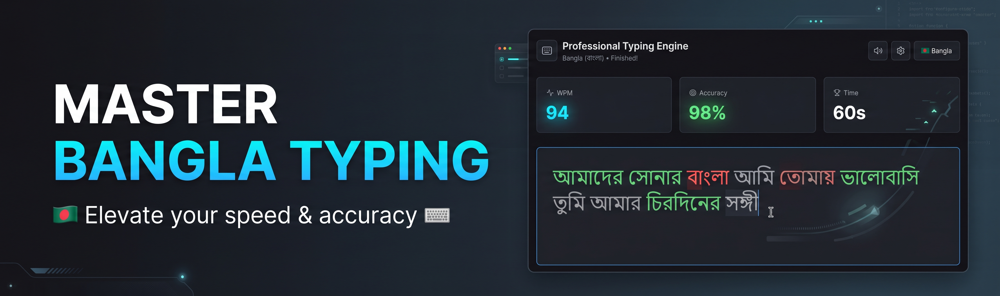

# ⌨️ Adaptive Typing Engine (Bangla & English)



[](https://adaptive-typing-application.vercel.app/)
[](#)
[](#)
[](#)

A high-performance, offline-first typing application featuring a custom-built state machine designed to seamlessly handle native Bangla (Bijoy) IME composition and English input. 

## ✨ Features

* **Native Bijoy Support:** Engineered to handle complex Bangla graphemes and IME input sequences without breaking state synchronization.
* **Custom State Machine:** Completely decoupled text generation and keystroke validation to prevent reactive rendering loops.
* **Offline-First Architecture:** Uses IndexedDB (via Dexie.js) to persistently store user statistics, WPM history, and accuracy metrics locally.
* **Strict Accuracy Mode:** Enforces backspace-disabled, 100% accuracy typing tests for hardcore practice.
* **Millisecond Precision:** Calculates WPM and accuracy using high-resolution timestamps rather than standard interval timers.

## 🛠️ Tech Stack

* **Frontend:** React, TypeScript, Tailwind CSS
* **Build Tool:** Vite
* **State Management:** Custom React Hooks (`useTypingEngine`)
* **Local Storage:** Dexie.js (IndexedDB)
* **Icons:** Lucide React

## 🚀 Live Demo

Try the application directly in your browser without any installation:
**[Test Your Typing Speed Here](https://adaptive-typing-application.vercel.app/)**

## 💻 Local Installation

To run this project locally on your machine:

1. Clone the repository:
   ```bash
   git clone (https://github.com/bdroast7-ai/adaptive-typing-application.git)
Navigate to the project directory:

Bash
cd adaptive-typing-application
Install dependencies:

Bash
npm install
Start the development server:

Bash
npm run dev
🧠 The Engineering Challenge
Handling the Bijoy layout in a React environment posed a unique challenge: native IME (Input Method Editor) composition often fires multiple synthetic events that can desync standard React state.

This project solves that by shifting the validation logic away from raw onChange events and implementing a static state transition model. It captures the exact millisecond a test finishes to prevent race conditions while ensuring that partial Bangla characters do not trigger false-positive error states.

Built by Mohammad Sheikh Riyasat Kibriya
